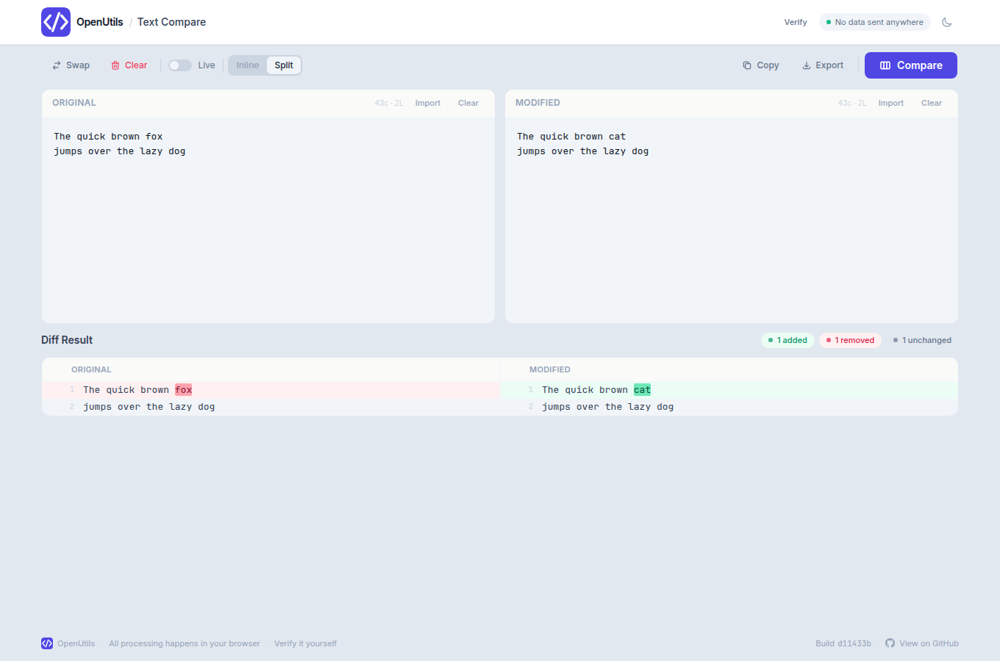
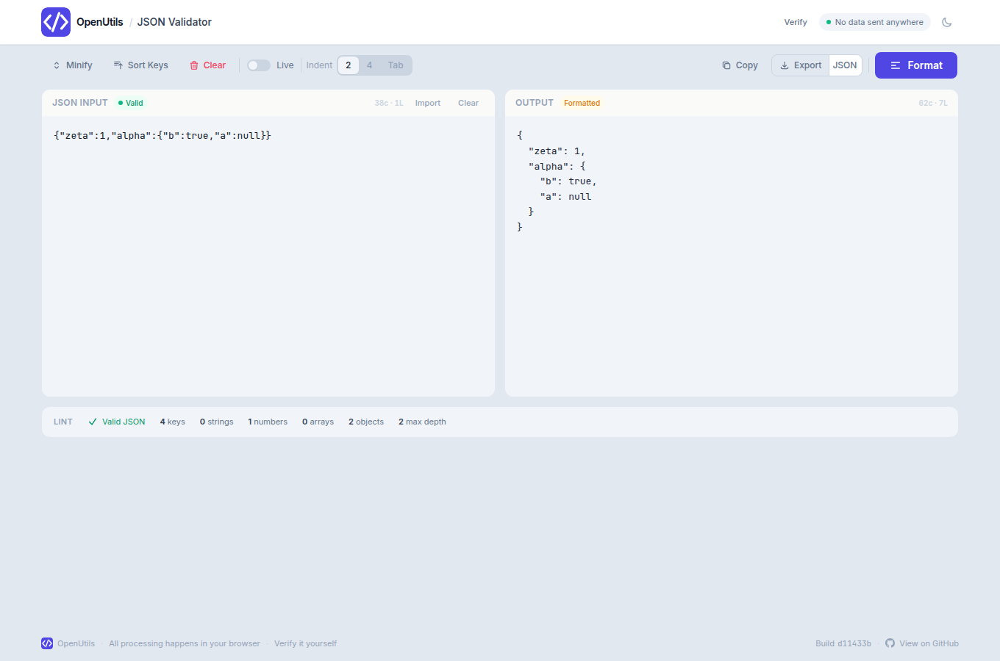
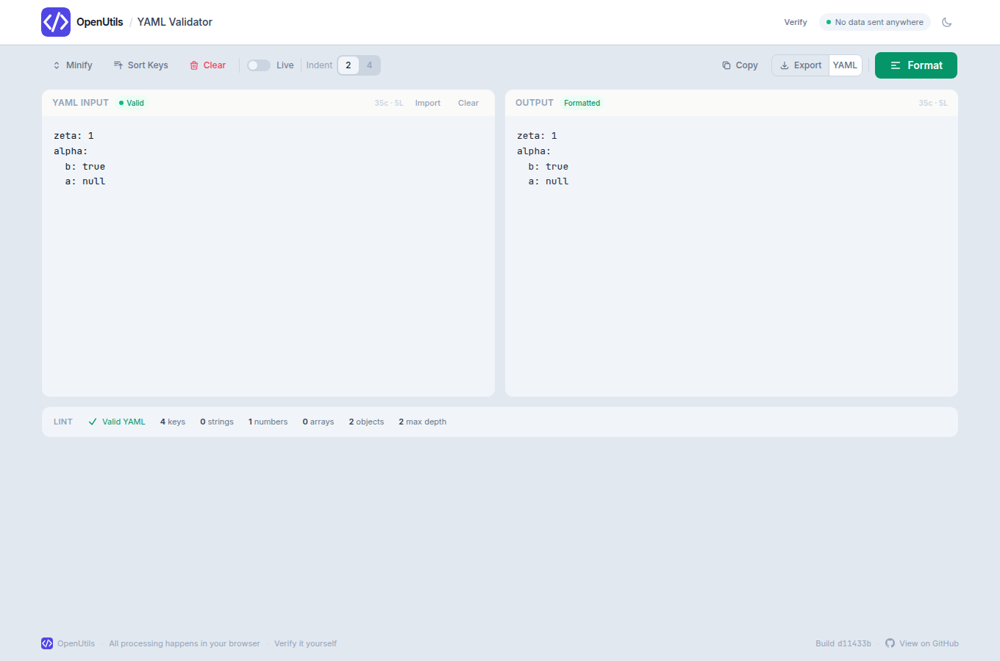
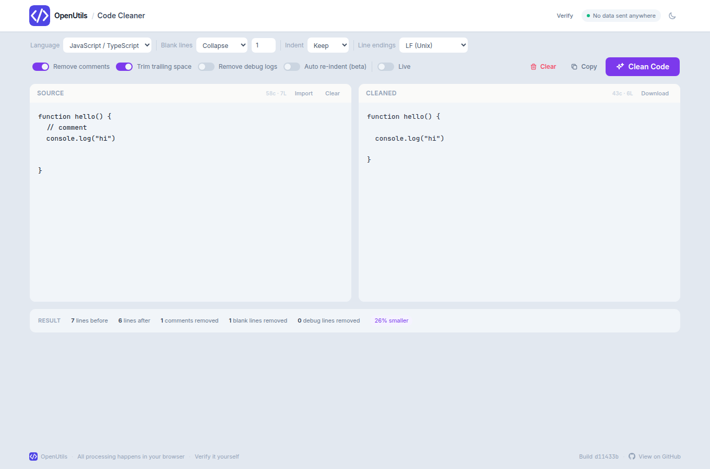
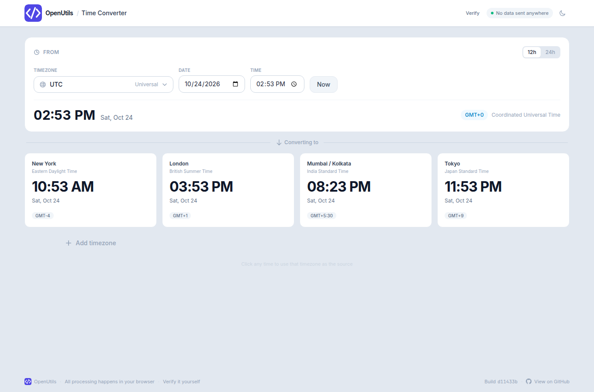

# OpenUtils

[openutils.tech](https://openutils.tech) is a small set of developer tools that run entirely in the browser. It is a static [Vite](https://vite.dev) + React single-page app, installed as a progressive web app, and hosted on Vercel. There is no application server and no account.

Text you paste, files you open, and times you convert stay on your device. The page does not call a tool API, and it does not load Google Fonts, analytics, or any other third-party host.

## Tools

| Tool | Route | What it does |
| --- | --- | --- |
| Text Compare | [/text-compare](https://openutils.tech/text-compare) | Word-level diff with inline and split views, live mode, and export. |
| JSON Validator | [/json-validator](https://openutils.tech/json-validator) | Format, minify, validate, and sort JSON, with error location and export. |
| YAML Validator | [/yaml-validator](https://openutils.tech/yaml-validator) | Format, minify, validate, and sort YAML, with error location and export. |
| Code Cleaner | [/code-cleaner](https://openutils.tech/code-cleaner) | Strip comments and tidy whitespace in 20+ languages. |
| Time Converter | [/time-converter](https://openutils.tech/time-converter) | Convert a time across time zones, with live mode and 50+ cities. |

A [Verify it yourself](https://openutils.tech/verify) page at `/verify` explains how to check the privacy claim in developer tools.

## Privacy promise

On a normal visit, including the first load, every network request stays on this origin (`openutils.tech`, or `localhost` when you run it yourself). Tool input is handled by JavaScript in the page. It is not posted anywhere.

What makes that checkable:

- **Fonts are files in this repo.** Inter (latin and latin-ext, variable) is in [`src/fonts`](src/fonts) and is bundled into the build. The SIL Open Font License is in [`src/fonts/OFL.txt`](src/fonts/OFL.txt). The old `fonts.googleapis.com` / `fonts.gstatic.com` tags are gone, and the service worker no longer has a Google Fonts cache route.
- **The browser is told to refuse anything else.** [`vercel.json`](vercel.json) sends a Content-Security-Policy of `default-src 'self'` on every route, plus `Referrer-Policy: no-referrer`, a restrictive `Permissions-Policy`, and `X-Content-Type-Options: nosniff`. Scripts, styles, fonts, images, and connections are limited to this site. `object-src` is `'none'`. Inline styles are not allowed. The only inline script is the JSON-LD block in `index.html`, allowlisted by its sha256 hash. The production build fails if that hash and the header drift apart.
- **The service worker is same-origin.** Registration is an external `registerSW.js`, not an inline script, so the policy does not need `'unsafe-inline'`.
- **The footer names the build.** The short hash links to that commit on [GitHub](https://github.com/CN-0/diff-checker). On Vercel it comes from `VERCEL_GIT_COMMIT_SHA`. Locally it comes from `git rev-parse HEAD`. If neither is available it shows `dev` and links to the repository.

Clicking "View on GitHub" opens GitHub on purpose. That click does not include tool text, and `no-referrer` means GitHub is not told which page you came from.

How to confirm it yourself: open [/verify](https://openutils.tech/verify), or the same route on a local production preview. The page walks through the Network tab, the CSP response header, and offline mode.

## Local development

Requirements: Node.js 22 (the app also builds on current Node 20).

```bash
npm install
npm run dev
```

The dev server is at `http://localhost:5173`.

`npm run dev` is for editing. It does not send the production security headers (Vite needs extra scripts for hot reload), and it does not register the service worker. Do not use it to judge the privacy headers or offline mode.

## Production build

```bash
npm run build
npm run preview
```

`npm run build` writes `dist/`. `npm run preview` serves that folder with the same response headers as [`vercel.json`](vercel.json), and the service worker registers, so install and offline mode match production. The preview URL is printed in the terminal (port 4173 by default).

Vercel builds with `npm run build` and applies `vercel.json` itself. No extra Vercel setting is required for the headers or the SPA fallback. The existing rewrite still sends every path to `index.html` so a refresh on `/text-compare` or `/verify` loads the app.

The footer hash is injected when Vite loads its config:

1. `VERCEL_GIT_COMMIT_SHA`, when Vercel sets it (the full SHA; the footer shows the first 7 characters and links to the full commit).
2. Otherwise `git rev-parse HEAD`.
3. Otherwise the literal `dev`.

## Screenshots

Home, with the five tools:


Text Compare:



JSON Validator, YAML Validator, Code Cleaner, and Time Converter:









Verify it yourself:


## License

[MIT](LICENSE). Copyright (c) 2026 Kongara Naveen.

Inter is bundled under the [SIL Open Font License](src/fonts/OFL.txt). Copyright 2016 The Inter Project Authors.
